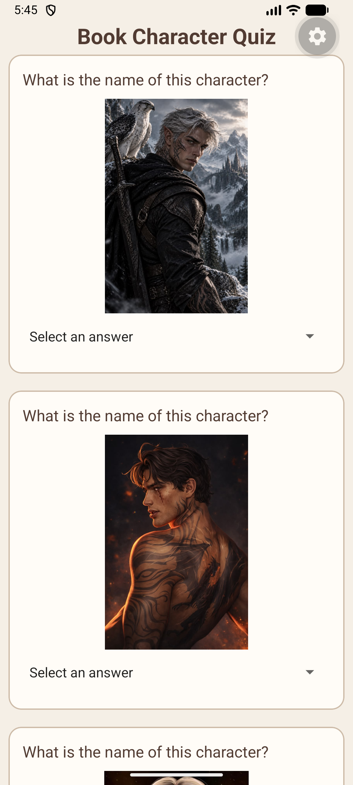
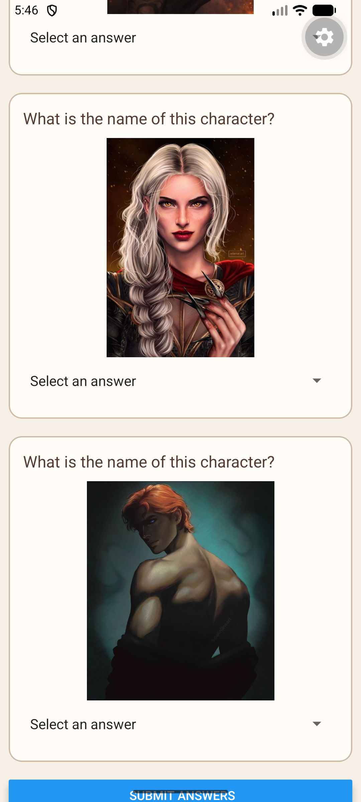

# Book Character Quiz
The Book Character Quiz is a mobile application designed for book lovers to test their knowledge of different fictional characters. Users are shown pictures of characters and must identify them by selecting the correct answer from the available options. The app also provides hints to help users identify the characters, making the quiz more interactive and enjoyable.

# Features Highlight
1. Character Questions – Displays pictures of book characters for users to identify.
2. Multiple-Choice Answers – Allows users to select their answers from a dropdown list.
3. Hint Feature – Provides extra pictures as hints when users tap on a character image.
4. Score Calculation – Calculates and displays the number of correct answers after submission.
5. Interactive Interface – Uses buttons, pop-ups and styled question cards to make the quiz easy to use.

# ScreenShots of App
Screenshots:  

# Demo Video
Demo Video Link:  
https://drive.google.com/file/d/1dJmV7m82sBkkABueq_ggrXugJmDulgz0/view?usp=sharing